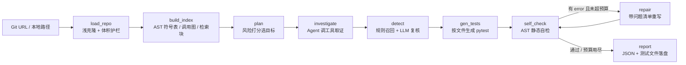

# 代码仓库静态分析 Agent

输入一个 Python 仓库地址，输出**可定位、可验证的缺陷报告 + 能直接跑的 pytest 用例**。
多步 Agent 由 LangGraph 编排，RAG 只是 Agent 手里的一个工具；**全程静态分析，不执行被分析代码**。

```
python -m codeagent.cli analyze --repo https://github.com/user/repo --max-targets 8
```

---

## 1. 它解决什么问题

代码审查类工具的常见问题有两个：

1. **只知道规则，不知道上下文**——报出一堆 `except` 太宽，但说不清这个函数被谁调用、影响面多大；
2. **只知道模型，不知道验证**——生成的测试看着像样，跑起来 import 就失败，还得人工一条条试。

这个项目把两者拆开：**规则负责召回（便宜、确定、可解释），模型负责精度（判断真假、补上下文），自检负责兜底（生成物先过静态校验才交付）**。
所以即使模型不可用，流水线仍然能给出 100% 召回的规则结论；模型可用时，再在预算内做复核。

## 2. 架构



**为什么这么切**：

| 阶段 | 谁来做 | 为什么 |
|---|---|---|
| 解析 | `ast` | 不 import 仓库代码，零执行风险；符号/调用图/复杂度全都能拿到 |
| 检索 | BM25 + FAISS + RRF | 代码检索里标识符精确匹配和语义匹配都需要，RRF 只用排名融合，不用调分数量纲 |
| 召回 | 25 条 AST 规则 | 便宜、确定、可复现；全仓扫 200 行代码约 2 秒 |
| 复核 | 本地 7B 模型 | 只处理预算内的目标，输出"真/假 + 证据行 + 修法"；行号一律以 AST 为准，不信模型自报 |
| 自检 | AST 校验器 | import 是否存在、符号是否存在、有没有未定义名、有没有副作用调用、目标是否被判到 |

## 3. 快速开始

```bash
# 1. 依赖
python -m venv .venv
.venv\Scripts\activate            # Windows
pip install -r requirements.txt

# 2. 可选：本地模型（不装也能跑，走规则 + 模板测试）
ollama serve
ollama pull qwen2.5-coder:7b
ollama pull qllama/bge-small-zh-v1.5

# 3. 分析
set PYTHONPATH=src                # Windows; Linux: export PYTHONPATH=src
python -m codeagent.cli analyze --repo samples/buggy_pkg --no-llm
python -m codeagent.cli analyze --repo samples/buggy_pkg --max-targets 6

# 4. 测试 / 评测
python -m pytest -q
python eval/run_eval.py           # 纯规则
python eval/run_eval.py --llm     # 带模型复核
```

输出：终端摘要 + `storage/<job_id>/report.json` + `storage/<job_id>/tests_generated/*.py`。

## 4. 服务与工具化

```bash
python -m codeagent.cli serve --port 8000
# POST /analyze        {"repo": "...", "max_targets": 6, "use_llm": true}
# GET  /jobs/{id}      任务状态
# GET  /jobs/{id}/report
```

MCP（stdio，可被任意支持 MCP 的客户端调用）：

```bash
python -m codeagent.mcp_server.server
# 工具：analyze_repo / search_code / list_symbols / get_symbol
```

## 5. 实测数据

评测集：`samples/buggy_pkg`（注入 20 条已知缺陷，逐条标注）+ `samples/clean_pkg`（同规模规范代码，作为误报基线）。
数据来自本机 2026-10-19 运行（Windows / CPU / qwen2.5-coder:7b），`eval/run_eval.py` 可复现。

| 指标 | 纯规则 | + LLM 复核（12 个目标） |
|---|---|---|
| 召回率 | **100%（20/20）** | **100%（20/20）** |
| clean_pkg 误报 | **0** | **0** |
| 结论条数 | 22 | 22 |
| 用例静态有效率 | **100%**（5/5） | **93.1%**（19/26） |
| 目标覆盖率 | 100% | 92% |
| 耗时 | **2s**（222 行 / 27 函数） | 142s（33 次模型调用） |

真实仓库抽测（`pallets/itsdangerous`，1727 行 / 105 函数）：纯规则 **14.5s**，54 条候选 → 7 条结论（INFO 已过滤），
说明规则在真实代码上不会"一报一大片"。

**这张表里最值得说的不是 100%，而是"两列都得 100% 召回"**：复核只做减法（否决误报）和加法（补充新问题），
不能因为模型没看出问题就把规则命中的结论丢掉——否则召回会被模型的不稳定拖垮。

> 修复前 LLM 模式的有效率只有 73.1%：自检报出 `requests` / `patch` / `DB_PATH` 未定义。
> 根因不是模型，是我把模型返回的顶层语句（import、常量、fixture）在拼接时丢了。
> 改成保留完整文件后升到 93.1%——这条正好说明为什么"生成"后面必须跟"静态自检"。

## 6. 设计取舍（面试会被追问的点）

**① 为什么不让模型直接读全仓？**
上下文装不下，而且成本随仓库线性涨。这里先用 AST + 规则把"哪里值得看"缩到 5–10 个函数，模型只看这些函数 + 检索到的调用方/相似实现。

**② 规则和模型冲突时听谁的？**
规则是召回，模型是精度：候选由规则产生，模型只能"确认/否决/补充"，不能凭空换一批。被否决的候选会记录在 trace 里，方便算"复核收益率"。

**③ 行号为什么不信模型？**
实测 7B 模型的 `lineno` 经常是相对行号（它看到的是函数片段，不是整个文件）。所以行号全部回填 AST 的位置，模型只负责"这条成不成立"。

**④ 自检为什么不是"跑一遍测试"？**
项目定位是静态分析，跑测试就等于执行不可信代码。这里改为 AST 层面的可运行性校验：import 是否真实存在、符号是否在模块里、有没有未定义名、有没有网络/文件/子进程调用需要 mock。校验不过就带着问题清单进修复环，最多 2 轮。

**⑤ 为什么不用向量库？**
一个仓库几千个函数，FAISS 暴力索引就够，落盘就是 `vectors.npy`。引入 Qdrant/Milvus 只会让部署变重。

## 7. 目录

```
src/codeagent/
  repo/loader.py       # 克隆/扫描 + 护栏
  repo/ast_index.py    # 符号表、复杂度、调用图、未使用导入
  retrieval/embed.py   # Ollama embedding / 确定性哈希兜底
  retrieval/hybrid.py  # BM25Plus + FAISS + RRF
  analysis/rules.py    # 25 条 AST 规则
  analysis/llm.py      # Ollama 封装 + JSON 抽取 + 降级
  testing/gen.py       # LLM / 模板两条生成通路
  testing/check.py     # 生成物静态自检
  agent/nodes.py       # LangGraph 节点
  agent/graph.py       # 图编排 + run_analysis
  api/main.py          # FastAPI
  mcp_server/server.py # MCP 工具服务
samples/               # 评测用正/负样本仓库
eval/                  # 标注集与评测脚本
tests/                 # 27 个单测（规则/索引/检索/自检/端到端）
```

## 8. 已知限制

- 只支持 Python（AST 决定），跨语言要另做解析器；
- 调用图是**名称级**解析，遇到同名函数/动态派发会漏边（只影响影响面判断，不影响缺陷定位）；
- 无 LLM 时生成的测试是"契约测试"（签名 + 必填参数），不是行为测试；
- 未做增量索引，每次分析重新解析（400 文件以内可接受）。

路线图：增量索引、多语言、按 PR diff 只审变更函数、复核收益率自动统计。
